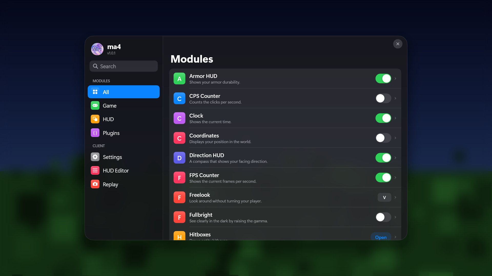
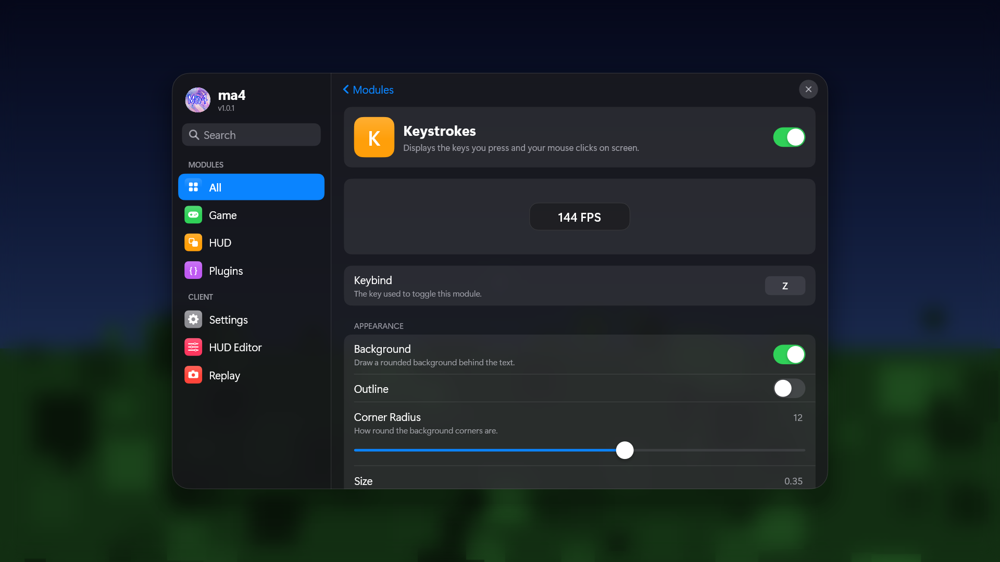
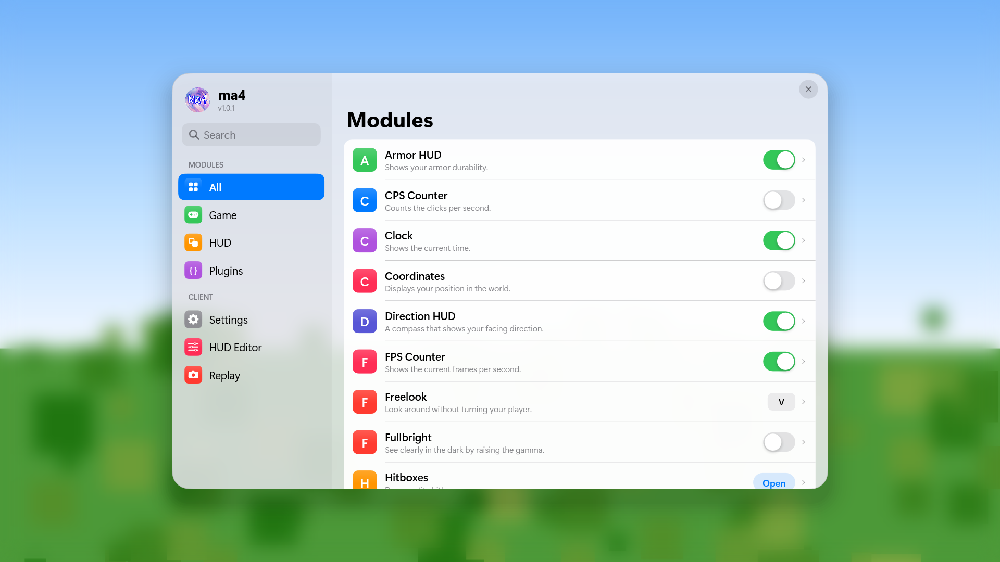
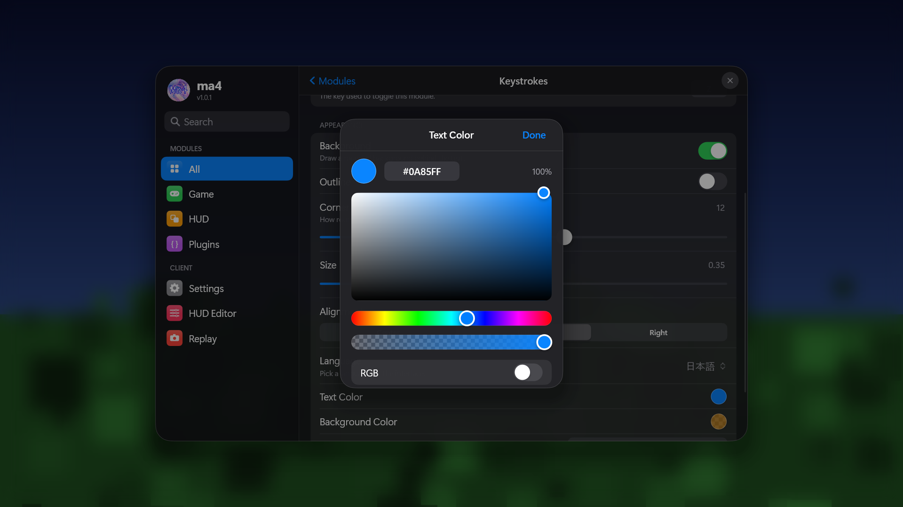
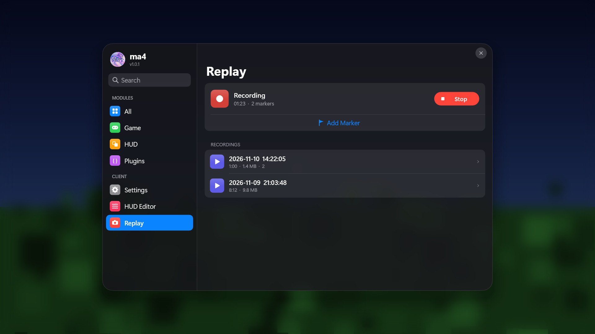
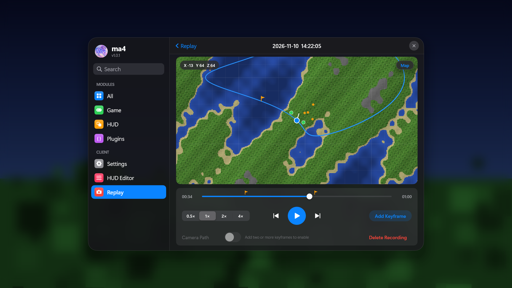

<p align="center"></p>

# ma4 Client  <small>v1.0.1</small>

**ma4 Client** is a DLL modification for Minecraft Bedrock Edition (Windows 10/11) with an iPhone / iOS styled
interface, 30+ customizable modules, a HUD editor, a replay recorder and a JavaScript plugin system.

> ma4 Client is a modified version of [Latite Client](https://github.com/LatiteClient/Latite) and is distributed under
> the same license (GNU GPL v3, see [LICENSE](LICENSE)). All of the game hooks, modules and the scripting engine come
> from Latite Client and its contributors.

## Preview

Rendered offline by [`tools/ui-harness`](tools/ui-harness) (same UI code as the DLL, fake data, procedural background).

| Modules (dark) | Module detail | Modules (light) |
| --- | --- | --- |
|  |  |  |

| Colour sheet | Replay recorder | Replay viewer |
| --- | --- | --- |
|  |  |  |

## What is different from Latite

- **Renamed** to ma4 Client (DLL: `ma4.dll`, data folder: `%AppData%\Roaming\ma4`).
- **iOS style UI.** The mod menu is rebuilt as an iPadOS "Settings app": sidebar + navigation stack, grouped inset
  lists, UISwitch, UISlider, segmented controls, pull-down menus, a colour sheet, large collapsing titles, continuous
  ("squircle") corners, translucent materials and spring-like motion. Dark and Light appearance, adjustable menu scale,
  right-to-left mirroring.
- **iOS style HUD.** HUD elements default to translucent rounded "widget" pills with a glass edge; the HUD editor,
  snap lines and notification banners use the same design language.
- **Typography.** SF Pro is used automatically when it is installed, otherwise Segoe UI Variable / Segoe UI.
- **Replay (beta).** A data recorder (your path, nearby players / mobs, markers, **terrain map**) and a Replay page
  with a top-down viewer: map, timeline scrubber with markers, play / pause, 0.5x - 4x speed, pan / zoom, and a
  keyframed camera path.
  See [Replay](#replay-beta) for what it does and does not do.

## Features

- **Clean interface**: search, sections, per-module detail pages with live HUD preview
- **30+ modules**: Motion Blur, Keystrokes, Zoom, FPS Counter, Toggle Sprint, ...
- **Plugin system**: JavaScript / TypeScript plugins (the plugin registry is still the upstream Latite one)
- **Customization**: accent colour, appearance, module positions, keybinds, fonts

## Building

### Prerequisites

- [Git](https://git-scm.com/download/win)
- Visual Studio 2022 / 2026 (or Build Tools) with the **Desktop development with C++** workload (MSVC x64, Windows
  SDK, CMake and Ninja)
- [MinGW-w64](https://www.mingw-w64.org/): ma4 uses MinGW's `ld.exe` to embed the files in `assets/` into the DLL, so
  its `bin` directory must be on your `PATH`
- `clang-format` (only needed for the optional pre-commit hook)

### Build from the command line

Open an **x64 Native Tools Command Prompt for VS**, make sure `cl`, `cmake`, `ninja` and `ld` work, then:

```powershell
cmake --preset x64-release
cmake --build out/build/x64-release
```

The first configure downloads the dependencies (glm, MinHook, nlohmann/json, libhat, EnTT, SDL3, ...). The DLL is
written to:

```text
out/build/x64-release/ma4.dll
```

| Preset               | Output                                  | Purpose                                      |
| -------------------- | --------------------------------------- | -------------------------------------------- |
| `x64-debug`          | `ma4Debug.dll` and `ma4Debug.pdb`       | Minimal optimization, full debugging info    |
| `x64-release`        | `ma4.dll`                               | Optimized build for normal use               |
| `x64-relwithdebinfo` | `ma4.dll` and `ma4.pdb`                 | Optimized build with debugging information   |
| `x64-nightly`        | `ma4Nightly.dll` and `ma4Nightly.pdb`   | Experimental configuration                   |

Inject the DLL into `Minecraft.Windows.exe` with the injector of your choice. The supported game version is listed in
`src/client/Ma4.h` (`supportedMinecraftVersions`).

## Replay (beta)

The recorder is a **read-only data recorder**: every game tick it stores your position / rotation and the players and
mobs around you (up to 40 within 64 blocks) plus markers you drop. It also samples the **terrain map**: the top block of
every column around you (colour + height, nearest chunks first, radius configurable in *Modules > Replay*), which the
viewer draws as a top-down map with hill shading (toggle with the **Map** button). Recordings are written to
`%AppData%\Roaming\ma4\Replays\*.ma4replay` when you stop (or when the maximum length is reached / you leave the
world).

- Start / stop from the **Replay** tab of the menu, or bind a key in *Modules > Replay*.
- Drop markers with the button or the *Marker Key* while recording.
- The viewer shows the recorded session on the terrain map (path, players, mobs, markers) with a scrubber, speed
  control, pan / zoom and a keyframed camera path.

It does **not** re-render the Minecraft world, so there is no free 3D camera inside the recorded world. That would
require recording and re-creating chunks and entities inside the game's own renderer, which needs deep, game-version
specific reverse engineering that cannot be validated here. Flarial's Replay Mod has no public documentation or source,
so its exact behaviour was not reproduced.

## Releasing (maintainers)

`tools/publish.ps1` commits everything, tags the version and pushes to this repository:

```powershell
.\tools\publish.ps1 -Version 1.0.2 -Message "What changed"
```

See [CHANGELOG.md](CHANGELOG.md) for the version history.

## Data folder

`%AppData%\Roaming\ma4` contains `Configs`, `Plugins`, `Logs`, `Replays`, `Assets` (ChakraCore for plugins). Delete the
folder to reset ma4 completely.

## Notes about external services

ma4 is a rename of Latite, so a few URLs still point to the upstream project because those files are hosted there:
the ChakraCore download, the plugin registry / hashes and the Discord application used by *Discord Presence* (which
therefore still shows the upstream application name and artwork). Replace them in `src/client/Ma4.cpp`,
`src/client/script/PluginManager.cpp`, `src/client/script/JsPlugin.cpp` and
`src/client/feature/module/modules/misc/DiscordPresence.h` (`discordApplicationId`) if you host your own.

## License

ma4 Client is free software: you can redistribute it and/or modify it under the terms of the GNU General Public
License v3. It comes without any warranty. Original work Copyright (C) Latite Client contributors.

---

**Disclaimer**: ma4 Client is not affiliated with Mojang or Microsoft in any way, shape, or form. Use at your own
risk on multiplayer servers.
