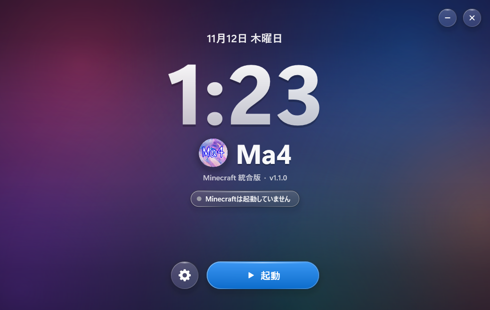
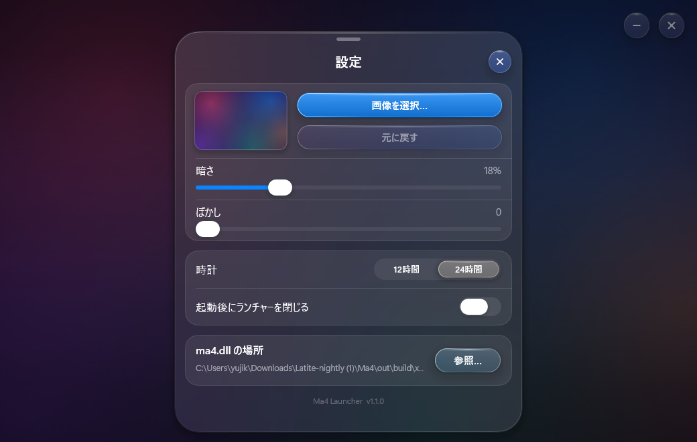
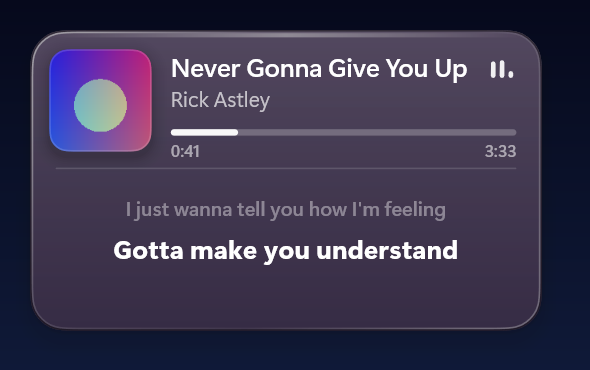
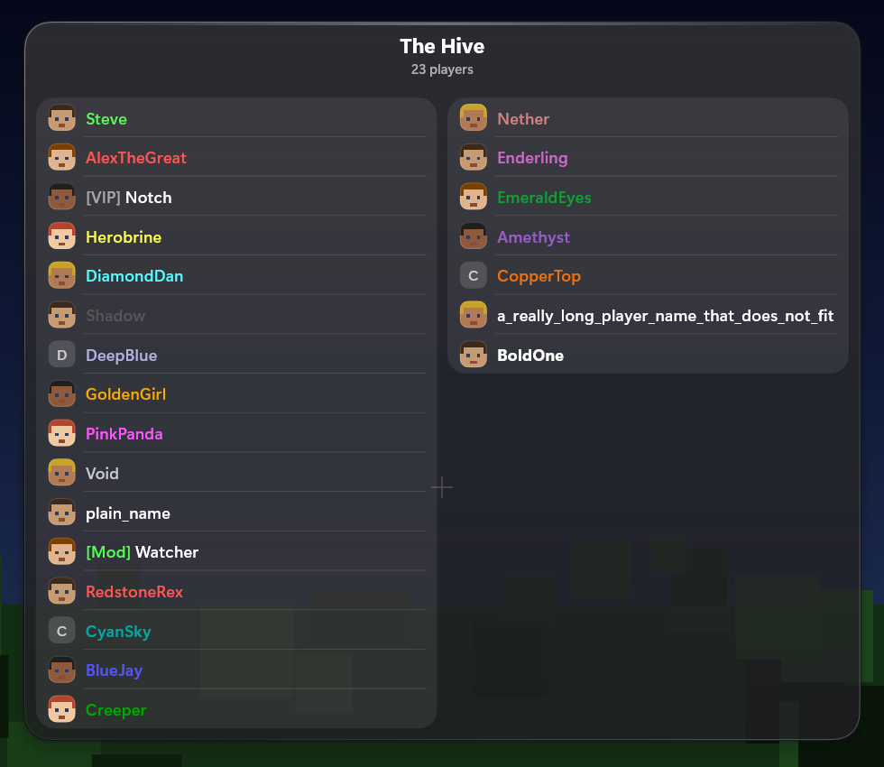

<p align="center"></p>

# ma4 Client  <small>v1.2.0</small>

**ma4 Client** is a DLL modification for Minecraft Bedrock Edition (Windows 10/11) with an iPhone / iOS styled
interface, 30+ customizable modules, a HUD editor, a replay recorder and a JavaScript plugin system.

> ma4 Client is a modified version of [Latite Client](https://github.com/LatiteClient/Latite) and is distributed under
> the same license (GNU GPL v3, see [LICENSE](LICENSE)). All of the game hooks, modules and the scripting engine come
> from Latite Client and its contributors.

## Preview

Rendered offline by [`tools/ui-harness`](tools/ui-harness) (same UI code as the DLL, fake data, procedural background).

| Modules (dark) | Module detail | Modules (light) |
| --- | --- | --- |
|  |  |  |

| Colour sheet | Replay recorder | Replay viewer |
| --- | --- | --- |
|  |  |  |

| Launcher | Launcher settings |
| --- | --- |
|  |  |

| Spotify HUD | Player list (Tab) |
| --- | --- |
|  |  |

## What is different from Latite

- **Renamed** to ma4 Client (DLL: `ma4.dll`, data folder: `%LocalAppData%\ma4`).
- **iOS 26 "Liquid Glass" UI.** The mod menu is an iPadOS Settings-style window: floating glass sidebar with a
  morphing selection capsule, navigation stack with floating glass back / close buttons and a scroll edge effect,
  grouped inset cards, an oval-knob switch, capsule sliders, glass segmented controls, a glass pull-down menu, a
  bottom colour sheet (drag down to dismiss), continuous ("squircle") corners and springs with overshoot. Dark and Light
  appearance, adjustable menu scale, right-to-left mirroring. The structure and motion follow the SwiftUI
  *Liquid Glass Examples* gallery; everything is re-implemented in Direct2D (see `src/client/screen/ios/IosGlass.cpp`).
- **Glass HUD.** HUD plates (text modules, keystrokes) get a glass sheen and specular rim; the HUD editor, snap lines
  and notification banners use the same design language.
- **Launcher.** `Ma4Launcher.exe` is an iOS lock-screen styled window (date, big clock, **Ma4** title, glass buttons over
  a wallpaper you can choose) that starts Minecraft and loads `ma4.dll`. See [Launcher](#launcher).
- **Spotify HUD and player list.** The song playing in Spotify (artwork, progress, synced lyrics) and the Tab player list
  are iOS cards too. See [Spotify HUD](#spotify-hud).
- **Typography.** SF Pro is used automatically when it is installed, otherwise Segoe UI Variable / Segoe UI.
- **Replay (beta).** A data recorder (your path, nearby players / mobs, markers, **terrain map**) and a Replay page
  with a top-down viewer: map, timeline scrubber with markers, play / pause, 0.5x - 4x speed, pan / zoom, and a
  keyframed camera path.
  See [Replay](#replay-beta) for what it does and does not do.

## Features

- **Clean interface**: search, sections, per-module detail pages with live HUD preview
- **30+ modules**: Motion Blur, Keystrokes, Zoom, FPS Counter, Toggle Sprint, ...
- **Plugin system**: JavaScript / TypeScript plugins (the plugin registry is still the upstream Latite one)
- **Customization**: accent colour, appearance, module positions, keybinds, fonts

## Building

### Prerequisites

- [Git](https://git-scm.com/download/win)
- Visual Studio 2022 / 2026 (or Build Tools) with the **Desktop development with C++** workload (MSVC x64, Windows
  SDK, CMake and Ninja)
- [MinGW-w64](https://www.mingw-w64.org/): ma4 uses MinGW's `ld.exe` to embed the files in `assets/` into the DLL, so
  its `bin` directory must be on your `PATH`
- `clang-format` (only needed for the optional pre-commit hook)

### Build from the command line

Open an **x64 Native Tools Command Prompt for VS**, make sure `cl`, `cmake`, `ninja` and `ld` work, then:

```powershell
cmake --preset x64-release
cmake --build out/build/x64-release
```

The first configure downloads the dependencies (glm, MinHook, nlohmann/json, libhat, EnTT, SDL3, ...). The DLL is
written to:

```text
out/build/x64-release/ma4.dll
```

| Preset               | Output                                  | Purpose                                      |
| -------------------- | --------------------------------------- | -------------------------------------------- |
| `x64-debug`          | `ma4Debug.dll` and `ma4Debug.pdb`       | Minimal optimization, full debugging info    |
| `x64-release`        | `ma4.dll`                               | Optimized build for normal use               |
| `x64-relwithdebinfo` | `ma4.dll` and `ma4.pdb`                 | Optimized build with debugging information   |
| `x64-nightly`        | `ma4Nightly.dll` and `ma4Nightly.pdb`   | Experimental configuration                   |

The same build also writes `Ma4Launcher.exe` next to `ma4.dll` (see [Launcher](#launcher)). You can load the DLL into
`Minecraft.Windows.exe` with it or with any injector of your choice. The supported game version is listed in
`src/client/Ma4.h` (`supportedMinecraftVersions`).

## Launcher

`Ma4Launcher.exe` (sources in [`launcher/`](launcher)) is a small native window in the style of the iOS lock screen: the
date, a big clock, the **Ma4** title and Liquid Glass buttons over a wallpaper. Keep it in the folder of `ma4.dll`.

- **Play** starts Minecraft Bedrock, waits for the game to create its renderer, then loads `ma4.dll` into it. If the game
  is already running the button says **Inject**; when ma4 is loaded it says **Active**. The status chip under the title
  says what is going on, or what went wrong.
- **Settings** (the gear): choose a **wallpaper** picture (it is copied to `%LocalAppData%\ma4\Launcher`, *Reset* goes
  back to the built-in aurora), **dim** and **blur** it, pick a 12 / 24 hour clock, close the launcher after launching,
  or point it to a `ma4.dll` somewhere else. The glass controls show a blurred copy of the wallpaper behind them.
- The window is dragged by the wallpaper, resizable, DPI aware, and uses almost no CPU while idle. The UI is Japanese or
  English depending on Windows.
- It needs no admin rights. To let the sandboxed game read the DLL it adds read / execute for *ALL APPLICATION
  PACKAGES* to `ma4.dll` itself (nothing else is touched).
- Command line: `Ma4Launcher.exe --inject <pid> <dll>` loads a DLL into a process;
  `Ma4Launcher.exe --render out.png [W H] [--sheet] [--state idle|running|ready|error|busy] [--wallpaper file]`
  draws one frame to a PNG without opening a window (how the screenshots above were made).

Not verified inside the real game: starting Minecraft and loading the DLL are the standard activation / `LoadLibraryW`
mechanisms and were tested against an ordinary process, but the launcher has not been run against the live game.

## Spotify HUD

The *Spotify* module (HUD tab) shows what Spotify is playing as an iOS "Now Playing" card: artwork, title, artist, a
progress bar with the time, and the lyrics of the song line by line.

- **Where the data comes from.** The song, the play state, the length and the position are read from the Windows media
  controls (the same source as the volume flyout and the lock screen), on a background thread. The position shown is the
  reported one plus the time since the report, so it is exact and follows seeks and pauses. If Windows cannot be asked, the
  title of the Spotify window is used (title and artist only; the position is then an estimate). With *Any Media Player*
  on, a browser or another player is shown when Spotify is not playing.
- **Lyrics** are looked up on [LRCLIB](https://lrclib.net), a free open database, in a background thread. The only things
  sent are the title, artist, album and length of the song, and only while *Show Lyrics* is on. A song without synced
  lyrics shows a short note instead; *Lyrics Offset* moves every line earlier or later if a recording is a little off.
- The module is hidden while nothing is playing (*Hide When Idle*); the HUD editor and the menu preview show a sample card.
- `tools/nowplaying-probe` contains two small programs that print what the reader sees and what the lyrics lookup returns,
  for troubleshooting without starting the game.

## Replay (beta)

The recorder is a **read-only data recorder**: every game tick it stores your position / rotation and the players and
mobs around you (up to 40 within 64 blocks) plus markers you drop. It also samples the **terrain map**: the top block of
every column around you (colour + height, nearest chunks first, radius configurable in *Modules > Replay*), which the
viewer draws as a top-down map with hill shading (toggle with the **Map** button). Recordings are written to
`%LocalAppData%\ma4\Replays\*.ma4replay` when you stop (or when the maximum length is reached / you leave the
world).

- Start / stop from the **Replay** tab of the menu, or bind a key in *Modules > Replay*.
- Drop markers with the button or the *Marker Key* while recording.
- The viewer shows the recorded session on the terrain map (path, players, mobs, markers) with a scrubber, speed
  control, pan / zoom and a keyframed camera path.

It does **not** re-render the Minecraft world, so there is no free 3D camera inside the recorded world. That would
require recording and re-creating chunks and entities inside the game's own renderer, which needs deep, game-version
specific reverse engineering that cannot be validated here. Flarial's Replay Mod has no public documentation or source,
so its exact behaviour was not reproduced.

## Releasing (maintainers)

`tools/publish.ps1` commits everything, tags the version and pushes to this repository:

```powershell
.\tools\publish.ps1 -Version 1.0.2 -Message "What changed"
```

See [CHANGELOG.md](CHANGELOG.md) for the version history.

## Data folder

`%LocalAppData%\ma4` contains `Configs`, `Plugins`, `Logs`, `Replays`, `Assets` (ChakraCore for plugins). Delete the
folder to reset ma4 completely.

## Discord Presence

With the *Discord Presence* module (on by default) Discord shows **"Playing Ma4"** while the client is running, plus
whether you are in the menus, in singleplayer or on a server. It uses Rich Presence over Discord's local IPC, so the
Discord desktop app must be running; no bot token is involved - only the public *Application ID*
(`discordApplicationId` in `src/client/feature/module/modules/misc/DiscordPresence.h`).

Two things have to be set once in the [Discord Developer Portal](https://discord.com/developers/applications) for that
application:

1. **General Information > Name** must be `Ma4` - Discord shows exactly this name after "Playing".
2. **Rich Presence > Art Assets**: upload [`docs/discord/ma4.png`](docs/discord/ma4.png) with the asset name `ma4`
   (it can take a few minutes until Discord serves a new asset). Without it the status still works, just without the
   image.

If you use a different application, replace the id in `DiscordPresence.h`.

## Notes about external services

ma4 is a rename of Latite, so a few URLs still point to the upstream project because those files are hosted there:
the ChakraCore download and the plugin registry / hashes. Replace them in `src/client/Ma4.cpp`,
`src/client/script/PluginManager.cpp` and `src/client/script/JsPlugin.cpp` if you host your own.

## License

ma4 Client is free software: you can redistribute it and/or modify it under the terms of the GNU General Public
License v3. It comes without any warranty. Original work Copyright (C) Latite Client contributors.

---

**Disclaimer**: ma4 Client is not affiliated with Mojang or Microsoft in any way, shape, or form. Use at your own
risk on multiplayer servers.
